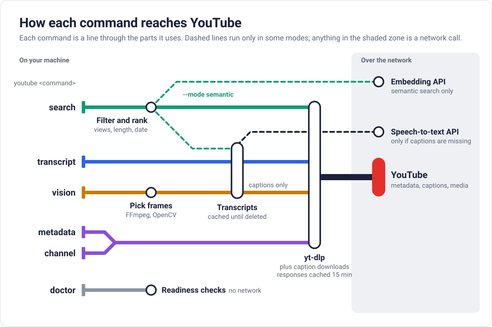
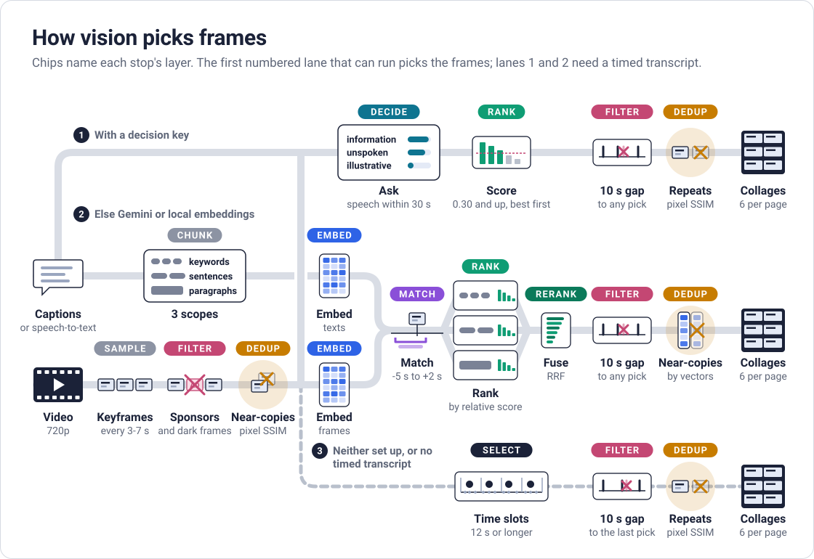

# YouTube Toolkit

A YouTube CLI for agents with directory-local request archives: search videos and comments, read transcripts, inspect metadata, and extract visual context through yt-dlp.



## Install

Requires Python 3.13+ and uv.

```bash
uv run python scripts/install.py
```

For visual extraction, install its optional dependencies and install `ffmpeg` separately:

```bash
uv run python scripts/install.py --vision
```

For local speech-to-text on videos without captions, install its optional dependencies (Hugging Face `transformers` and PyTorch) and install `ffmpeg` separately:

```bash
uv run python scripts/install.py --stt
```

The installer replaces the installed `youtube` tool; combine `--vision --stt` to install both optional capabilities. To run the checkout directly, use `uv run youtube`.

## API keys and configuration

Run the interactive setup to save embedding and speech-to-text settings for this application:

```bash
youtube setup
youtube setup --embeddings
youtube setup --stt
```

Without flags, setup configures both capabilities; combine `--embeddings --stt` to explicitly select both.
Keys use hidden prompts, and there are no command-line key flags.
Press Enter to keep an existing saved value, or enter `-` to remove its saved override.
Canceling before completion saves nothing.

Settings are saved in an application-specific `config.env` using `.env` syntax (`KEY=value`):

| Platform | Configuration file |
| --- | --- |
| macOS | `~/Library/Application Support/youtube-toolkit/config.env` |
| Linux | `${XDG_CONFIG_HOME:-~/.config}/youtube-toolkit/config.env` |
| Windows | `%APPDATA%/youtube-toolkit/config.env` |

`XDG_CONFIG_HOME` overrides the configuration directory on both Linux and macOS.
Setup changes no shell startup files or `PATH` settings.
Keys are stored in this local file, with access restricted to the current user on POSIX systems; they are not stored in the OS keychain.
Nonblank environment variables override saved settings, followed by the defaults documented below.
For example, an exported `EMBEDDING_MODEL` takes precedence over the model saved by setup.
The file accepts comments, quoted values, and optional `export` prefixes; values are read literally without expanding `${VARIABLE}` references or exporting them to the process environment.

Prompts appear on stderr; the final JSON reports the configuration path and saved setting names without their values.
Setup makes no API calls or model downloads; use the readiness commands below when you want to check the configured routes.

## Examples

```bash
youtube search "langgraph tutorial" --limit 5 --max-duration 20:00
youtube search "reasoning models" --channels @OpenAI --channels @Anthropic --uploaded-within-days 30 --sort recency
youtube search --channels @OpenAI --limit 5
youtube channel @OpenAI --last 5
youtube channel @OpenAI --days 7
youtube metadata <url-or-id>
youtube comments <url-or-id> "pricing"
youtube transcript <url-or-id>
youtube transcript <url-or-id> --timestamps
youtube transcript <url-or-id> --export
youtube vision <url-or-id>
youtube stt-setup
youtube doctor
```

Commands return JSON except `doctor`, which reports local readiness without contacting YouTube or model APIs. `stt-setup` checks the configured speech-to-text routes separately; it does not retrieve a YouTube video.

## Search and channel listings

Search covers YouTube by default, or the uploads of the channels named with `--channels`:

| Command or mode | Query behavior | Default ordering |
| --- | --- | --- |
| Native YouTube search | Query required; several queries are interleaved and duplicate videos removed | YouTube relevance |
| Native channel search (`--channels`) | Query optional; titles must contain any supplied query, case-insensitively | Recency |
| `youtube channel` | Direct upload listing, without queries or search filters | Latest first |

`--sort popularity` orders native search results by views; native YouTube search rejects `--sort recency`. Repeat `--channels` to combine channels.

For `youtube channel`, `--last N` selects the latest uploads. `--days N` uses a UTC date window and fetches upload dates, skipping videos it cannot date; `--last` then sets the initial listing size rather than capping the final results.

Search defaults can be overridden with these flags:

| Flag | Default | Controls |
| --- | --- | --- |
| `--limit` | 10 for YouTube; 30 for channel searches | Maximum results returned |
| `--min-views` | 10,000 | Minimum video views |
| `--min-duration` | `3:00` | Minimum video duration |
| `--max-duration` | `8:00:00` | Maximum video duration |

Use `youtube search --help` for all filters and overrides.

Channel listings omit upload dates, so recency sorting and date filters require per-video metadata requests. Other filters fetch metadata only when a required field is missing.

### Semantic search

Semantic search shortlists videos by title, then uses an embedding API to rank transcript passages:

```bash
youtube search "agent memory" --mode semantic --limit 5
youtube search "model evals" --channels @OpenAI --mode semantic --return video
```

Configure embeddings with `youtube setup --embeddings`, or supply the same settings through environment variables:

| Variable | Default | Purpose |
| --- | --- | --- |
| `EMBEDDING_API_KEY` | Required; no default | API key for the embedding service |
| `EMBEDDING_BASE_URL` | `https://api.openai.com/v1` | OpenAI-compatible API endpoint |
| `EMBEDDING_MODEL` | `text-embedding-3-small` | Embedding model |
| `EMBEDDING_DIMENSIONS` | 1,536 | Requested vector dimensions |
| `EMBEDDING_CONCURRENCY` | 16 | Parallel requests, clamped to 1–50 |

Results are passages by default; `--return video` ranks videos by their best matching passage. With several queries, each passage is scored against its closest query. Duplicate texts share an embedding request within each stage, and results are ranked by similarity.

Semantic search reads captions only and never invokes speech-to-text. Partial caption or embedding failures are summarized in result `warnings`; the command fails if no transcript passage can be embedded. An empty result list means no passage met the similarity threshold. Passage `chunk_index` values are not timestamps; use `transcript --timestamps` for caption timing.

## Comment search

Search a video's Top comments for a keyword or phrase in one command:

```bash
youtube comments <url-or-id> "pricing"
youtube comments <url-or-id> "training data" --limit 250
youtube comments <url-or-id> "pricing" | jq '.comments[] | select((.like_count // 0) >= 10)'
```

The command fetches up to 100 top-level comments in YouTube's Top order by default, excludes replies, and then matches the optional query as a case-insensitive literal substring of comment text, like `rg -i -F`.
The query is one keyword or phrase; regex and OR expressions are not interpreted.
`--limit` accepts 1-1000 and defaults to 100; values outside that range fail before contacting YouTube.
It controls how many comments are fetched before filtering, not the number of matches; sparse matches never trigger more retrievals.
For an intentional unfiltered sample, use `youtube comments <url-or-id>`; passing an empty query has the same effect.
No model API or API key is required.

After filtering, results alternate between the next unseen comment in YouTube's Top order and the next unseen comment ranked by descending likes.
Comments are deduplicated internally by ID.
Within the like-count ranking, ties preserve Top order and unavailable counts sort last.
This interleaving changes the order within the fetched sample, not retrieval coverage or the number of network requests.

JSON output contains only `title`, `url`, and `comments`; each comment contains only `text` and `like_count`.
Unavailable like counts are `null`, and no matches or no available comments produces `comments: []`.

```json
{
  "title": "Example video",
  "url": "https://www.youtube.com/watch?v=VIDEO_ID",
  "comments": [
    {"text": "The pricing comparison was helpful.", "like_count": 12}
  ]
}
```

Every fetch saves the unfiltered sample in its original Top order under `.cache/youtube-toolkit/comments/`, using the same lean JSON fields as stdout.
Timestamped filenames keep each retrieval separate; the saved JSON has no metadata wrapper.

## Metadata and transcripts

Metadata includes descriptions, thumbnails, and chapters. Transcripts return a JSON string by default or timed chunks with `--timestamps`. Manual English or Chinese subtitles are preferred, with the video's language family tried first; otherwise the toolkit uses original-language automatic captions. It excludes machine-translated tracks, converts Chinese transcript text to Taiwan Traditional, and removes caption spans overlapping SponsorBlock segments.

When no usable captions exist, the transcript command falls back to [speech-to-text](#speech-to-text) if configured. STT output has no timing: `--timestamps` returns one chunk with zero start and end. Caption download failures remain errors.

`--export` writes metadata and transcript text to `<normalized-title>_<normalized-channel>.txt` in the working directory and returns its path. Combine it with `--timestamps` for a timed export. `--force` replaces an existing export and requires `--export`.

## Visual context

Vision returns timestamped collages and per-frame measurements in JSON. Timed captions choose where to look and local image analysis picks the frames; without usable timed captions it samples evenly. No model API or speech-to-text is used.

| Setting or limit | Value |
| --- | --- |
| Screenshots (`--max-frames`) | Default 6; accepts 1–96; repetitive content can yield fewer |
| Collage layout | Up to six screenshots per page, in 2 columns × 3 rows |
| Maximum video duration | 2 hours |
| Maximum temporary video size | 500 MiB |

For example, `--max-frames 12` allows up to 12 screenshots. Collages remain under `.cache/youtube-toolkit/vision/` after the downloaded video is removed.



## Speech-to-text

The transcript command selects a cloud provider when its key is set, otherwise a local model when its dependencies and `ffmpeg` are installed. Provider errors propagate; local transcription is selected only when the cloud key is absent. With neither route available, the no-captions error is returned.

Use `youtube setup --stt` to save the provider, its API key, and the local model setting, or supply them through environment variables.

`STT_PROVIDER` chooses the cloud provider, and each one needs its own key:

| `STT_PROVIDER` | Key | Model |
| --- | --- | --- |
| `elevenlabs` | `ELEVENLABS_API_KEY` | `scribe_v2` |
| `gemini` | `GEMINI_API_KEY` | `gemini-3.5-transcribe` |
| `openai` | `OPENAI_API_KEY` | `gpt-transcribe` |
| `vercel` | `AI_GATEWAY_API_KEY` | `spacexai/grok-stt` through Vercel AI Gateway |
| `xai` (default) | `XAI_API_KEY` | `grok-voice-transcribe-2.0` |

Gemini and the Vercel gateway each transcribed an hour of audio in under a minute. Gemini accepts recordings up to one hour, and OpenAI accepts files up to 25 MB, which is about 25 minutes of YouTube audio.

The local model is `nvidia/parakeet-tdt-0.6b-v3`, or the Hugging Face ASR model ID in `STT_LOCAL_MODEL`. The local route runs any model that works in the `transformers` `automatic-speech-recognition` pipeline, on an Nvidia GPU, an Apple GPU, or the CPU. The model downloads the first time it is needed. An unknown `STT_PROVIDER`, or a local model that cannot be loaded, falls back to the default with a warning on stderr.

Parakeet covers 25 European languages only and returns noise for others such as Chinese. For those, use the cloud route or set `STT_LOCAL_MODEL=openai/whisper-large-v3-turbo`. On an Apple M5, Parakeet transcribed an hour of audio in 45 seconds and Whisper large-v3-turbo took about 4 minutes.

Configuration and readiness commands have different effects:

| Command | Purpose | Downloads or API calls |
| --- | --- | --- |
| `youtube setup` | Saves embedding and STT settings interactively | None |
| `youtube doctor` | Local runtime and configuration readiness | None; creates no files and loads no model |
| `youtube stt-setup` | Reports both STT routes and tests the local route when its dependencies and `ffmpeg` are available | Downloads the local model if needed; no cloud request |
| `youtube stt-setup --cloud-test` | The same local checks, plus a two-second cloud test recording | May download the local model; sends a real request billed by the cloud provider |

If the local dependencies or `ffmpeg` are unavailable, `stt-setup` reports that the local route is not installed.
`doctor` and `stt-setup` check configuration; use `setup` to enter and save keys.

## Local artifacts

Run commands from the directory where their research artifacts belong. Fresh yt-dlp metadata, comments, search listings, channel listings, and normalized transcript documents are archived under `.cache/youtube-toolkit/`, with a UTC timestamp and a readable identifier in each filename. Comment archives contain only `title`, `url`, and `comments`, with `text` and `like_count` per comment; other JSON artifacts contain `request`, `fetched_at`, and `payload`. Repeated retrievals preserve earlier copies.

Saved copies are never automatically reused or expired. Semantic rankings and embeddings stay in memory for the current search. Long text fields in JSON stdout are capped at 400,000 characters; transcript exports and archived documents retain the complete text.

## Agent skill

The repository skill is [skills/youtube/SKILL.md](skills/youtube/SKILL.md).
