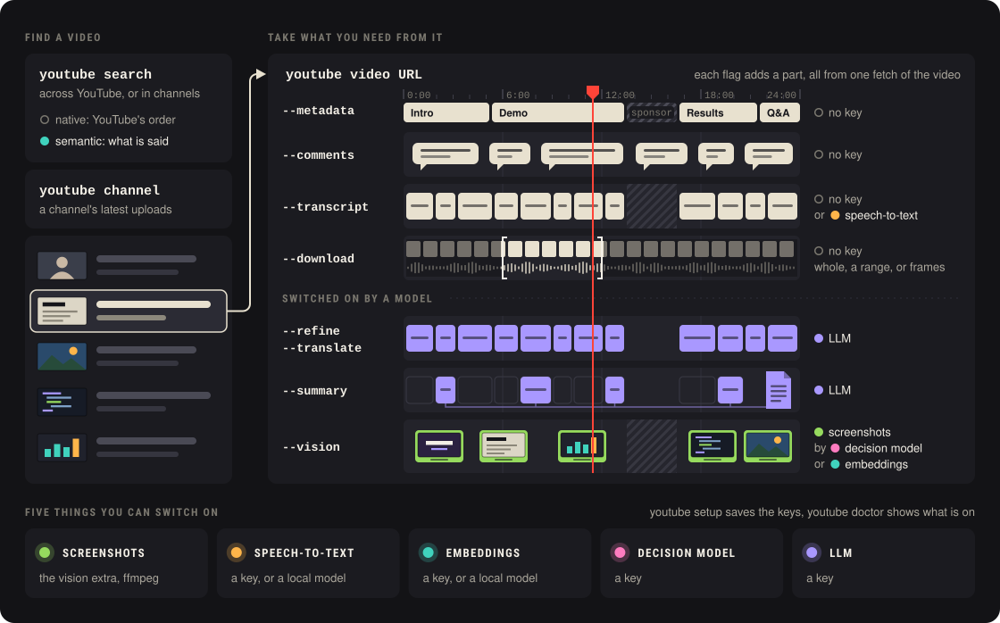
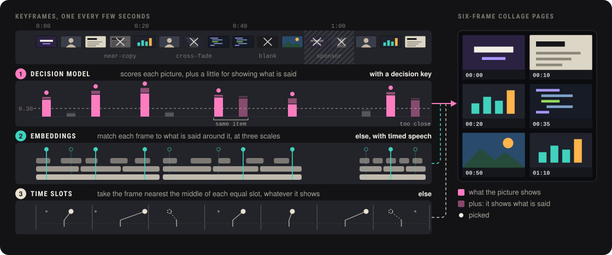

# YouTube Toolkit

A YouTube CLI for agents: search videos, fetch their metadata, transcripts, comments, and curated screenshots, and download them. It is modular: the core needs no keys, and screenshots, speech-to-text, embeddings, a decision model, and an LLM each switch on once you install or set them up, with a provider you choose or, for embeddings and speech-to-text, a local model.



## Install

Requires Python 3.13+ and uv. The installer installs `youtube` as a uv tool; rerun it after pulling changes. Add `--vision` for screenshots, `--embeddings` for the local embedding model, or `--stt` for local speech-to-text; vision, speech-to-text, and downloads also need `ffmpeg`.

```bash
uv run python scripts/install.py --vision
```

## Configuration

```bash
youtube setup
youtube setup --decisions
youtube doctor
```

`youtube setup` saves keys and model settings, or one group with `--embeddings`, `--decisions`, `--stt`, or `--llm`; keys are entered at hidden prompts. Settings live in a user-only `.env` under `~/Library/Application Support/youtube-toolkit/` on macOS, `~/.config/youtube-toolkit/` on Linux, or `%APPDATA%/youtube-toolkit/` on Windows, and environment variables override them. `youtube doctor` checks readiness without the network.

> [!TIP]
> Any `*_API_KEY` setting can hold another variable's name instead of a key: enter `AI_GATEWAY_API_KEY` at the prompt to reuse that variable's value, read each time a command runs, so the key itself is never stored in the settings file.

| Variable | Used for | Default |
| --- | --- | --- |
| `DECISION_API_KEY` | Picking screenshots with a decision model | |
| `DECISION_BASE_URL` | Any host serving TypeSafe's System One API | Vercel AI Gateway |
| `DECISION_MODEL` | The decision model; it must read images | `perplexity/pplx-decider-flash-v1.3` |
| `EMBEDDING_API_KEY` | Semantic search, and picking screenshots with Gemini Embedding 2 | |
| `EMBEDDING_BASE_URL`, `EMBEDDING_MODEL` | Any OpenAI-compatible embedding API | Gemini, `gemini-embedding-2` |
| `EMBEDDING_LOCAL_MODEL` | Embeddings without a key | `jinaai/jina-embeddings-v5-omni-small-retrieval` (non-commercial) |
| `STT_PROVIDER` | Cloud speech-to-text | `xai` |
| `STT_LOCAL_MODEL` | Speech-to-text without a key | `nvidia/parakeet-tdt-0.6b-v3` (European languages) |
| `LLM_API_KEY` | Refining, translating, and summarizing transcripts | |
| `LLM_BASE_URL`, `LLM_MODEL` | Any OpenAI-compatible chat API | Vercel AI Gateway, `openai/gpt-6-luna` |

Speech-to-text providers are `xai` (`XAI_API_KEY`), `elevenlabs` (`ELEVENLABS_API_KEY`), `vercel` (`AI_GATEWAY_API_KEY`), `openai` (`OPENAI_API_KEY`), and `gemini` (`GEMINI_API_KEY`).

## Usage

```bash
youtube video URL_OR_ID --transcript --timestamps
youtube video URL_OR_ID --transcript --translate zh-TW --export
youtube video URL_OR_ID --summary
youtube video URL_OR_ID --transcript --vision --export
youtube video URL_OR_ID --download --start 1:15 --end 2:30
youtube video URL_OR_ID --comments "QUERY"
youtube video URL_OR_ID
youtube search "langgraph tutorial" --limit 5 --max-duration 20:00
youtube search "reasoning models" --in-channels @OpenAI --days 30 --sort recency
youtube search "agent memory" --semantic chunk
youtube channel @OpenAI --last 5
```

Every command and flag; an option nested inside a flag's brackets needs that flag:

```text
youtube video URL_OR_ID
        [--transcript [--timestamps] [--refine] [--export [--fresh]] [--stt] [--translate [LANGUAGE]]]
        [--summary [LANGUAGE] [--stt] [--translate [LANGUAGE]]]
        [--vision [--max-frames N] [--rows N] [--columns N] [--resolution 360p|540p|720p] [--min-gap SECONDS] [--min-similarity COSINE] [--local-only] [--no-auto-clean] [--fresh]]
        [--download [video|audio] [--quality 360p|480p|720p|1080p] [--start TIME] [--end TIME] [--fresh]]
        [--comments [QUERY] [--comment-limit N]]
        [--metadata]
youtube search QUERY ...
        [--semantic chunk|video] [--in-channels CHANNEL ...]
        [--limit N] [--sort relevance|recency|popularity]
        [--days N] [--uploaded-after YYYY-MM-DD]
        [--min-views N] [--min-duration TIME] [--max-duration TIME]
        [--include-channel-names TEXT ...] [--exclude-channel-names TEXT ...]
        [--include-titles TEXT ...] [--exclude-titles TEXT ...]
youtube channel CHANNEL [--last N] [--days N]
youtube setup [--embeddings] [--decisions] [--stt] [--llm]
youtube stt-check [--cloud-test]
youtube doctor
```

Commands print JSON, and `--help` lists each command's options. Responses are archived under `.cache/youtube-toolkit/` in the working directory.

`video` is modular: each part flag adds its part to the output, keyed by part, and any mix of parts shares one metadata fetch; without flags it returns the metadata alone.

- `--transcript` prefers manual subtitles, then automatic captions, never machine translations, and falls back to speech-to-text, when configured, if there are none; `--stt` uses speech-to-text even when captions exist. `--refine` cleans it up with an LLM, and `--translate` translates it into English, or `--translate LANGUAGE` into another language. `--export` writes it to a text file, or with `--vision` to a Markdown file beside the collages.
- `--summary` summarizes the transcript with an LLM, in the transcript's language, the `--translate` language, or `--summary LANGUAGE`; the transcript itself is printed only with `--transcript`.
- `--vision` picks screenshots, ranked against the same transcript when `--transcript` is given, and lays them out at 540p in collages of three rows of two, or at the `--resolution` and in the grid that `--rows` and `--columns` set.
- `--download` saves the video with its sound as an mp4 of up to 1080p, or the `--quality` you choose, or with `--download audio` the sound alone as an m4a, named like an export in the working directory; `--start` and `--end` keep a range, which opens at the keyframe at or before the start, and with `--vision` a whole video downloaded at 720p or more is where the frames are picked. Video file names hold the quality and range, so a file already there for the same request comes back as it is, with a message, unless `--fresh` downloads it again.
- `--comments` samples the top 100 comments, or up to 1000 with `--comment-limit`, and keeps those containing the query.

`search` covers YouTube, or the channels named with `--in-channels`, and by default keeps videos with at least 10,000 views and 3 minutes to 8 hours long. `--semantic chunk` ranks caption passages with embeddings, and `--semantic video` returns their videos.

`channel` lists a channel's latest uploads: the last 10, `--last N`, or `--days N`.

## Refine and translate


Without `--timestamps`, the transcript comes back as paragraphs of complete sentences, under the video's chapter titles when it has them; with it, each caption line is rewritten on its own timestamps. `--refine` fixes typos, punctuation, and grammar slips and drops filler sounds such as "um", keeping the speaker's wording, and `--translate LANGUAGE` takes any wording the model understands, such as `zh-TW` or `Japanese`. Both spell names from the video's title and description. A transcript already in the requested language comes back unchanged unless `--refine` is given.

## Vision



The first available route picks the frames. With `DECISION_API_KEY`, a decision model judges each frame's picture and, where there is speech, whether it shows what is being said, then keeps one view of each thing shown; a 26-minute video costs about a cent. Otherwise embeddings match frames to nearby speech, and without either, frames are spread over time. The picked frames are saved beside the collages, so rerunning a video with only `--rows`, `--columns`, or a resolution no higher than before changed lays the same frames out again in seconds, without downloading or ranking; any other vision option, a higher resolution, a new ranking model, a new toolkit version, or `--fresh` picks afresh. Frames are always picked from 540p candidates: `--resolution 360p` shrinks the picks to save image tokens at the cost of small text and digits, and `--resolution 720p` decodes them again from the 720p download.

## Agent skill

The repository skill is [skills/youtube/SKILL.md](skills/youtube/SKILL.md).
