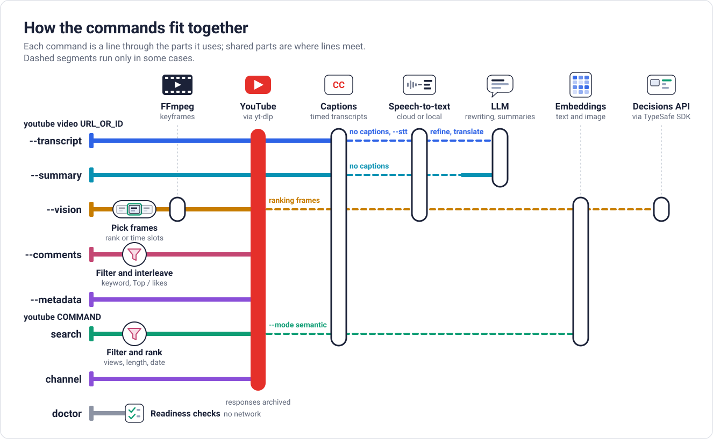
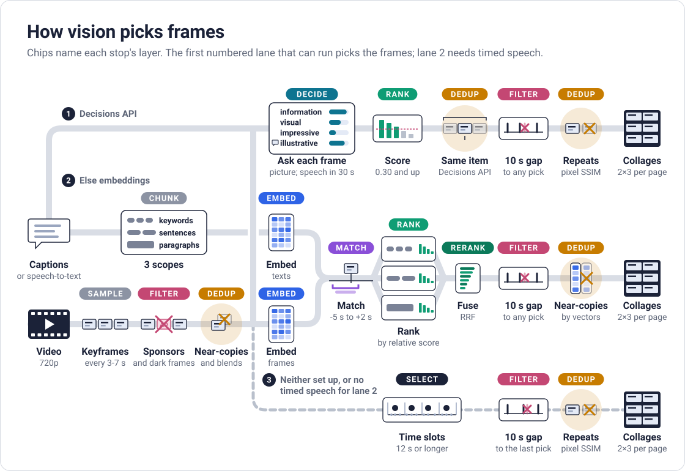

# YouTube Toolkit

A YouTube CLI for agents: simple search and fetching of videos, metadata, transcripts, and comments, plus curated screenshots for visual context.



## Install

Requires Python 3.13+ and uv. The installer installs `youtube` as a uv tool; rerun it after pulling changes. Add `--vision` for screenshots, `--embeddings` for the local embedding model, or `--stt` for local speech-to-text; vision and speech-to-text also need `ffmpeg`.

```bash
uv run python scripts/install.py --vision
```

## Configuration

```bash
youtube setup
youtube setup --decisions
youtube doctor
```

`youtube setup` saves keys and model settings, or one group with `--embeddings`, `--decisions`, `--stt`, or `--llm`; keys are entered at hidden prompts. Any `*_API_KEY` setting can hold another variable's name, such as `AI_GATEWAY_API_KEY`, to reuse that variable's value. Settings live in a user-only `.env` under `~/Library/Application Support/youtube-toolkit/` on macOS, `~/.config/youtube-toolkit/` on Linux, or `%APPDATA%/youtube-toolkit/` on Windows, and environment variables override them. `youtube doctor` checks readiness without the network.

| Variable | Used for | Default |
| --- | --- | --- |
| `DECISION_API_KEY` | Picking screenshots with a decision model | |
| `DECISION_BASE_URL` | Any host serving TypeSafe's System One API | Vercel AI Gateway |
| `DECISION_MODEL` | The decision model; it must read images | `perplexity/pplx-decider-flash-v1.2` |
| `GEMINI_API_KEY` | Picking screenshots with Gemini Embedding 2 | |
| `EMBEDDING_API_KEY` | Semantic search | |
| `EMBEDDING_BASE_URL`, `EMBEDDING_MODEL` | Any OpenAI-compatible embedding API | Gemini, `gemini-embedding-2` |
| `EMBEDDING_LOCAL_MODEL` | Embeddings without a key | `jinaai/jina-embeddings-v5-omni-small-retrieval` (non-commercial) |
| `STT_PROVIDER` | Speech-to-text when captions are missing | `xai` |
| `STT_LOCAL_MODEL` | Speech-to-text without a key | `nvidia/parakeet-tdt-0.6b-v3` (European languages) |
| `LLM_API_KEY` | Translating transcripts | |
| `LLM_BASE_URL`, `LLM_MODEL` | Any OpenAI-compatible chat API | Vercel AI Gateway, `openai/gpt-6-luna` |

Speech-to-text providers are `xai` (`XAI_API_KEY`), `elevenlabs` (`ELEVENLABS_API_KEY`), `vercel` (`AI_GATEWAY_API_KEY`), `openai` (`OPENAI_API_KEY`), and `gemini` (`GEMINI_API_KEY`).

## Usage

```bash
youtube video URL_OR_ID --transcript --timestamps
youtube video URL_OR_ID --transcript --vision --export
youtube video URL_OR_ID --comments "QUERY"
youtube video URL_OR_ID
youtube search "langgraph tutorial" --limit 5 --max-duration 20:00
youtube search "reasoning models" --channels @OpenAI --uploaded-within-days 30 --sort recency
youtube search "agent memory" --mode semantic
youtube channel @OpenAI --last 5
```

Commands print JSON, and `--help` lists each command's options. Responses are archived under `.cache/youtube-toolkit/` in the working directory.

- `video` returns the parts its flags name, keyed by part, from one metadata fetch, or the metadata alone without flags:
  - `--transcript` prefers manual subtitles, then automatic captions, never machine translations, and falls back to speech-to-text, when configured, if there are none; `--stt` uses speech-to-text even when captions exist, and `--translate` translates it into English, or `--translate LANGUAGE` into another language, as timestamped sentences. `--export` writes it to a text file, or with `--vision` to a Markdown file beside the collages.
  - `--vision` picks screenshots and lays them out in collages of six, ranked against the same transcript when `--transcript` is given.
  - `--comments` samples the top 100 comments, or up to 1000 with `--comment-limit`, and keeps those containing the query.
- `search` covers YouTube, or the channels named with `--channels`, and by default keeps videos with at least 10,000 views and 3 minutes to 8 hours long. `--mode semantic` ranks caption passages with embeddings.

## Vision



The first available route picks the frames. With `DECISION_API_KEY`, a decision model judges each frame's picture and, where there is speech, whether it shows what is being said, then keeps one view of each thing shown; a 26-minute video costs about a cent. Otherwise embeddings match frames to nearby speech, and without either, frames are spread over time.

## Agent skill

The repository skill is [skills/youtube/SKILL.md](skills/youtube/SKILL.md).
